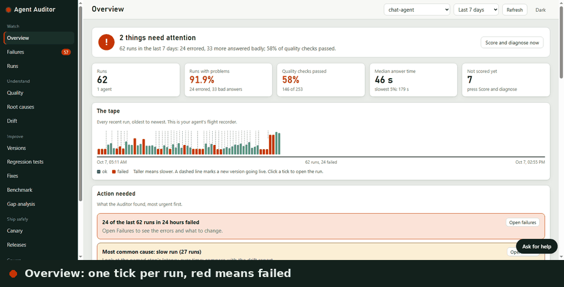
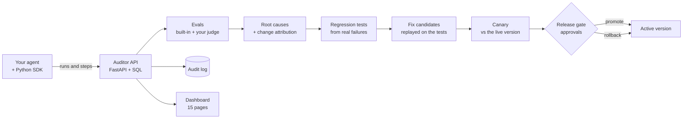

<h1 align="center">Agent Auditor</h1>

<p align="center"><b>Find out why your AI agent fails, and prove the fix works before you ship it.</b></p>

<p align="center">
  <a href="https://pypi.org/project/agent-auditor/"></a>
  
  
  
  
  
</p>

<p align="center">
  <a href="https://arathis1.github.io/agent-auditor/demo/"><b>Live demo</b></a> &middot;
  <a href="https://arathis1.github.io/agent-auditor/">Website</a> &middot;
  <a href="https://arathis1.github.io/agent-auditor/docs/">Docs</a> &middot;
  <a href="https://arathis1.github.io/agent-auditor/docs/case-study.html">Case study</a>
</p>

Agent Auditor is an open-source reliability layer for AI agents. It records every agent run, scores it, explains why
failures happen, turns real failures into regression tests, and only lets a new version go live after a canary check
and a human approval. Everything lands in an audit log.

> **Status: alpha.** All planned phases are written and tested: tracing, evals, drift, failure-to-test, root
> causes, canary, release gate, change attribution and verified fixes, plus a plain-language dashboard and a working
> demo agent. It has been used on one developer's machine, not in production. See [Known limitations](#known-limitations).

<p align="center"></p>

## Why this exists

Tracing tools show you what an agent did. When it breaks in production you still have to work out why, write the test
by hand, change something, and hope the change did not break something else. Agent Auditor closes that loop:

```
run -> score -> root cause -> regression test -> proposed fix -> replay the tests -> canary -> approved release -> rollback
```

| Step | What you get |
|---|---|
| **Trace** | Every run with its steps (model calls, tools, retrieval) from a small Python SDK |
| **Evaluate** | Built-in checks that need no API key (errors, latency, empty answers, grounding, "I am not sure" answers), your own answer key, and an optional model judge for wrong answers |
| **Explain** | A root-cause label per failure (rate limit, tool error, bad retrieval, slow run...) and which change likely caused it |
| **Remember** | One click turns a failed run into a regression test that is replayed against every new version |
| **Compare** | Drift detection and a canary that rolls back a version that is measurably worse |
| **Ship safely** | Release gate with approvals (you cannot approve your own), rollback, and a full audit trail |

### How it fits together



## Try it in two minutes

Needs Python 3.11 or newer. No API key is needed for the core.

```bash
pip install agent-auditor
agent-auditor demo
```

`agent-auditor demo` starts the dashboard with made-up sample data (a support bot with a bad afternoon, a good
candidate and a bad one) and opens it in your browser. Nothing is saved. Prefer to look first? Open the
[hosted live demo](https://arathis1.github.io/agent-auditor/demo/).

To run it for real with your own database, use `agent-auditor serve`. To work on the code, install from source:

```bash
git clone https://github.com/ArathiS1/agent-auditor
cd agent-auditor
python -m venv .venv && source .venv/bin/activate      # Windows: .venv\Scripts\activate
pip install -e ".[dev]"
```

**Windows, one command:** `powershell -ExecutionPolicy Bypass -File .\run-all.ps1` starts the Auditor and the chat app
together, connected, and opens the dashboard. Add `-Check` to run a 23-point self-check afterwards.

**Docker (API, worker, PostgreSQL):** `cp .env.example .env`, set the two secrets, `docker compose up --build`.
See [docs/deployment.md](docs/deployment.md).

## Use it with your own agent

```python
from agent_auditor.sdk import Auditor

auditor = Auditor("http://127.0.0.1:8000", agent="support-bot")
auditor.register_version("v1", prompt=PROMPT, config={"top_k": 4})

@auditor.observe(kind="retrieval")
def kb_search(q): ...

@auditor.observe_run()
def answer(question): ...
```

Plain Python and LangGraph/LangChain are supported. See `examples/quickstart_plain.py` and `examples/langgraph_demo.py`.

**Already using OpenTelemetry?** Point your exporter at the Auditor and keep your code as it is. It accepts the standard
OTLP/HTTP endpoint, reads OpenInference, OTel GenAI, OpenLLMetry and Langfuse span attributes, and turns each trace into a run:

```bash
pip install "agent-auditor[otel]"
agent-auditor serve --api-key demo-key
export OTEL_EXPORTER_OTLP_ENDPOINT=http://127.0.0.1:8000
export OTEL_EXPORTER_OTLP_HEADERS="x-api-key=demo-key"
```

`service.name` becomes the agent, `service.version` the version and `deployment.environment` the environment. Saved traces
import with `agent-auditor import-otlp traces.json`. See [docs/importing-traces.md](docs/importing-traces.md).

## The dashboard

Open `/dashboard`. Fifteen pages, grouped by what you are trying to do:

| Group | Pages |
|---|---|
| Watch | Overview (health verdict, one tick per run), Failures, Runs |
| Understand | Quality, Root causes, Drift |
| Improve | Versions, Regression tests, Fixes, Benchmark, Gap analysis |
| Ship safely | Canary, Releases |
| Govern | Audit log, Setup |

Every chart has a table view, and "Ask for help" answers questions from beginner to advanced (it works without a key
from a built-in guide, and uses an AI provider when one is configured).

## Auditor Chat: a real agent to watch

`chatbot/` is a ChatGPT-style app that runs on your machine and reports every turn to Agent Auditor, so you always
have a real agent to inspect. It streams answers, remembers conversations, reads files and images, searches the web,
runs deep research, and compares models side by side.

- **Many providers:** Gemini, Groq, OpenRouter, Mistral, Cerebras, DeepSeek, xAI, Perplexity, OpenAI, Claude, Ollama,
  and any OpenAI-compatible service you describe in `.env` (`NAME_API_KEY`, `NAME_BASE_URL`, `NAME_MODEL`).
- **Auto-routing:** the chat remembers which models are slow or rate limited and tries healthy, quick ones first
  (`CHAT_AUTOROUTE=off` to disable). `GET /api/health` shows what it has learned.
- **Key doctor:** `python chatbot/check_keys.py` says plainly whether each key works, is out of credit, or is busy.

Details: [chatbot/README.md](chatbot/README.md).

## What it found on a real agent

Running the chat app as a live agent for a few days, the Overview reported most runs as problems. The cause was not a
bug in the code: slow free or reasoning models tripped the latency check, and free tiers returned rate limits. That
finding led directly to the auto-routing above. The point of the tool is that it showed this with evidence, per version
and per cause, instead of leaving it as a feeling that "the bot is flaky".

## How well does it work?

`validation/` tests the tool against a support bot whose faults are planted, so the right answer is known.
On the included sample run:

- 3 of 5 planted faults were rolled back by the canary every time.
- Half-missing search results were caught 3 times in 5.
- **Out-of-date facts were never caught.** The built-in checks look at symptoms, not facts.

On real models the canary has produced a hold, a promote and a rollback (the rollback used a planted fault). The same pair of models earned a hold one day and a promote two days later, because the default policy only fails latency at 2x. See the [case study](docs/case-study.md#4-a-change-gated-by-a-canary).

Run it yourself: `python validation/run_validation.py --dry-run`. Report and method: [validation/README.md](validation/README.md).

## Design choices

- **Fixes are proposals, not automatic edits.** Rule-based candidates come from the root-cause report. A person registers
  one, the regression suite replays against it, a canary compares it, and a different person approves the release.
  Many failures (slow runs, rate limits) are infrastructure problems that no prompt change fixes.
- **Cheap checks first.** Built-in scorers need no API key, so the system works offline and costs nothing to run.
- **Plain HTML dashboard.** No build step and no CDN, served by the API itself.

## A failure, start to finish

What the loop looks like on a real incident (numbers are illustrative):

1. **Overview** turns red: *"31 of 52 runs had problems."*
2. **Root causes** says why: *slow run (25 runs), rate limit (14 runs), tool error (3 runs)*, and in which version it began.
3. **Failures** lists each run. One click turns a bad run into a **regression test**.
4. **Fixes** proposes small candidates. Each is registered as a separate, inactive version and replayed on every
   regression test. Only candidates that pass are recommended.
5. **Canary** sends a slice of live traffic to the candidate and compares pass rate, latency and causes with the live version.
6. **Releases**: a different person approves, you promote, and if it goes wrong you roll back with a written reason.
   Every step, including refusals, is in the audit log.

## What is built

| Area | Contents | State |
|---|---|---|
| Core | Data model, FastAPI ingestion, versioned prompts and configs, audit events, Python SDK, LangGraph adapter | done |
| Evals | 9 built-in scorers (including answer-key and non-answer checks), an optional model judge, version-to-version regression verdicts | done |
| Drift | Numeric, rate and term-mix signals with significance tests | done |
| Failure to test | Failed runs become deduplicated regression cases; replay against any version | done |
| Root causes | 11 cause types with sub-causes, suspect documents, change attribution | done |
| Canary and releases | Five checks, approval gate, rollback, audit trail | done |
| Fixes | Rule-based and optional AI candidates, verified on the regression suite | done, human-approved |
| Dashboard | 15 pages, plain HTML/CSS/JS, dark mode, built-in help chatbot | done |
| Auditor Chat | Multi-provider demo agent with auto-routing and key checks | done |
| Ops | Docker Compose, PostgreSQL, Alembic migrations, CI, background worker | done, PostgreSQL experimental |

## Roadmap

Planned, in rough order. The last three items are done.

- [ ] One-click "apply and verify" for fix candidates (register, replay and canary in one step)
- [ ] Real user authentication, so approvers are verified and not typed names
- [ ] Row locking for several operators on one release
- [ ] Fact-checking scorers that compare answers with source documents, not just symptoms
- [ ] A green PostgreSQL CI job, then promote PostgreSQL to supported
- [x] Published package on PyPI (`pip install agent-auditor`)
- [x] Checks for wrong and empty answers without an answer key (`gives_an_answer`, optional `answer_judge`)
- [x] Import traces from any OpenTelemetry exporter (OTLP, JSON or protobuf)

## FAQ

**Is this an observability tool like LangSmith or Langfuse?** Partly. Those show what happened. Agent Auditor adds the
steps after that: diagnosing the cause, writing the test, checking the fix and gating the release. It is much younger
and smaller than they are, so pick it for the closed loop, not for scale.

**Does it need an API key?** No. Tracing, evals, root causes, drift, canary and releases run offline. Keys are only for
the optional AI helper, AI-written fixes and the demo chat app.

**Will it fix my agent automatically?** No, by design. It proposes and proves fixes; a person approves the release.
Many failures, such as slow runs and rate limits, come from the model or provider, and no prompt edit fixes them.

**Can I use it with my own agent?** Yes. Add the SDK decorators shown above to any Python agent.

## Documentation

| | |
|---|---|
| [docs/reference.md](docs/reference.md) | Every phase in detail: evals, drift, failure-to-test, root causes, canary, releases, attribution. See the Troubleshooting section for port conflicts. |
| [docs/architecture.md](docs/architecture.md) | How the pieces fit |
| [docs/deployment.md](docs/deployment.md) | Docker, PostgreSQL, secrets |
| [docs/importing-traces.md](docs/importing-traces.md) | Send OpenTelemetry traces to the Auditor: how spans map to runs, and the limits |
| [docs/answer-correctness.md](docs/answer-correctness.md) | Catching wrong or empty answers when you have no answer key, and what that cannot catch |
| [docs/publishing.md](docs/publishing.md) | How a release reaches PyPI |
| [docs/case-study.md](docs/case-study.md) | A worked example: Agent Auditor watching its own chat agent, including what did not work |

## Known limitations

- Alpha software. It has been run on one machine and is not yet proven under production load.
- Without an answer key, the built-in checks catch errors, slowness and non-answers ("I am not sure"), not confident wrong
  answers. For those you give the runs expected answers, or turn on the optional model judge, which sends each question and
  answer to a model you choose and can itself be wrong. See [docs/answer-correctness.md](docs/answer-correctness.md).
- The OpenTelemetry import maps spans by convention (OpenInference, OTel GenAI, OpenLLMetry, Langfuse) and has been tested
  with the Python SDK and hand-written traces only. gRPC export is not supported. See [docs/importing-traces.md](docs/importing-traces.md).
- Approver names are self-asserted behind one shared API key. Promotion marks a version active; it deploys nothing.
- Replay needs an agent that can be called again with the stored inputs. Agents that depend in live sessions or
  external state cannot be replayed faithfully.
- The AI helper can be wrong, so decisions stay with a person. With a provider configured, dashboard figures and your
  question are sent to that provider.
- The feature comparison in Gap analysis is kept by hand and may be out of date.
- The PostgreSQL CI job is experimental; SQLite is the tested backend.
- More in [docs/reference.md](docs/reference.md#known-limitations).

## Development

```bash
pip install -e ".[dev]"
ruff check src tests examples chatbot
pytest -q
```

Contributions are welcome: see [CONTRIBUTING.md](CONTRIBUTING.md). Never commit `.env` or `chat.db`.

## License

MIT. See [LICENSE](LICENSE).
