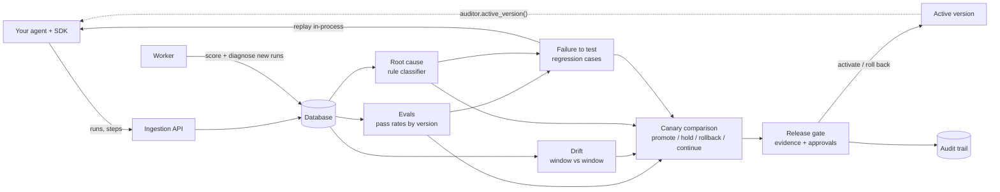

# Architecture

Agent Auditor is a closed loop: observe agent runs, turn failures into tests, explain them, and gate every change
with evidence.

## Pieces

| Package | Job | Pure core (no database) | Phase |
|---|---|---|---|
| `api/`, `models.py` | Ingestion, versions, audit events | - | 1 |
| `sdk/` | Tracing, replay, canary router, client calls | `serialize`, `_mapper` | 2 |
| `evals/` | Scorers, pass-rate comparison between versions | `scorers`, `compare`, `stats` | 3 |
| `drift/` | Is the current window different from the reference? | `detect`, `stats` | 4 |
| `regress/` | Failures become de-duplicated regression cases, replay verdicts | `fingerprint`, `expectations` | 5 |
| `rootcause/` | Why did this run fail? | `classify`, `summary`, `errors` | 6 |
| `canary/` | Candidate vs baseline: five checks, one verdict | `checks`, `decide` | 7 |
| `release/` | Gate, approvals, promotion, rollback | `gate` | 8 |
| `worker.py` | Scores and diagnoses new runs outside requests | `run_once` | 9 |

Every package keeps its statistics and decision rules in plain functions that take plain data. That is why most of
the logic can be tested without a database, and why a number in a report can be traced to one small function.

## Data flow

1. The SDK sends each run (input, output, ordered steps, version label, environment) to `POST /v1/runs`.
   It never raises into your agent; a background thread with a bounded queue does the sending.
2. The worker (or an explicit API call) writes `EvalResult` rows and `RunDiagnosis` rows. Everything later reads
   those rows instead of re-reading steps.
3. Failed runs become `RegressionCase` rows (one per fingerprint). Replaying the suite against a candidate version
   produces a `ReplayRun` with per-case outcomes.
4. A canary evaluation compares the candidate's `canary` runs with the baseline's `production` runs and stores a
   `CanaryReport`.
5. A `Release` asks to make the candidate active. The gate reads the newest canary report, the newest replay and the
   approvals; promotion flips `AgentVersion.is_active`; rollback flips it back.
6. Every state change writes an `AuditEvent`, including refusals.

## Design decisions worth knowing

- **Statistics are conservative and explicit.** Fisher exact tests, Bonferroni correction across the scorers or
  causes tested, effect-size thresholds on top of p-values, and "insufficient data" as a first-class answer.
- **Rules before models.** Root-cause classification is a deterministic rule set with stated precedence, so a
  diagnosis can be explained and a wrong one can be fixed by editing a rule.
- **`strength` is not a probability.** It says how much evidence a rule had, not how often it is right.
- **The database is the integration point.** No message broker. The worker polls; Postgres is the only service
  besides the API.
- **Promotion is a record, not a deployment.** The platform marks which version is active; your service reads it.

## What is deliberately not here

User authentication and authorization (one shared API key), multi-tenant isolation, a streaming ingestion path,
LLM-as-judge scorers, and automatic rollback. Each is a reasonable next step, and none is claimed.
