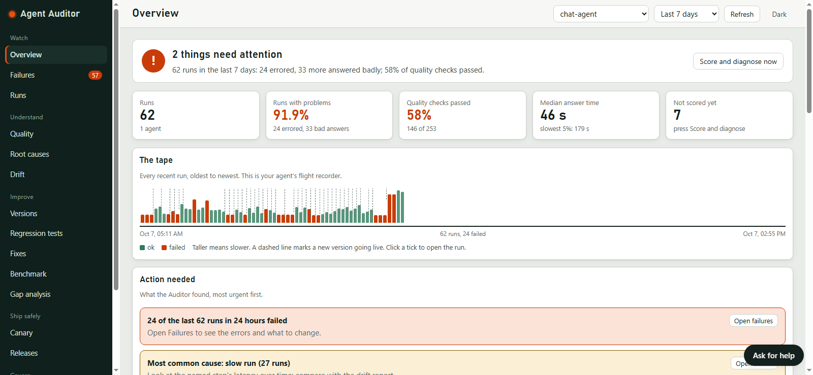
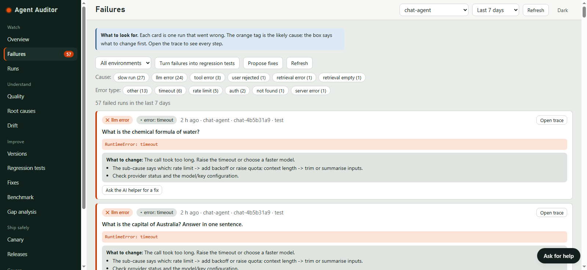
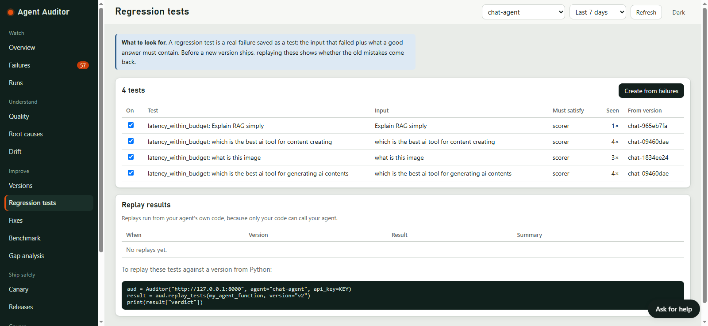
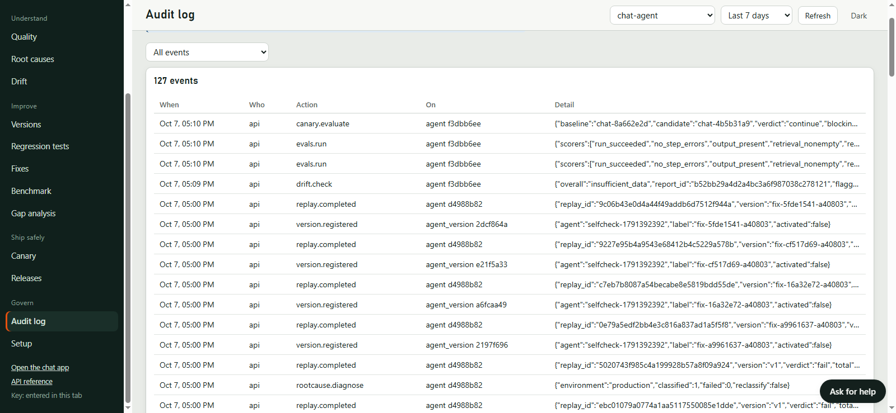

# Case study: Agent Auditor watching its own chat agent

I ran Agent Auditor against the demo agent in this repo (Auditor Chat) for about a day, switching between many models
and providers, and read what the dashboard reported. This is what it showed, including where it fell short.
Numbers come from the dashboard on 7 October 2026 (agent `chat-agent`, last 7 days). The run counts are small, so treat
this as a worked example and not a benchmark.

## 1. The agent
- **What it does:** a ChatGPT-style assistant that answers questions, uses a calculator and web search, and reads files.
  Every chat turn is recorded as one run (a step per model call and per tool call). I was the only user.
- **Stack:** Python standard-library server, with the model chosen per conversation. Each model is registered as its
  own agent version (`chat-<hash>`), so the dashboard can tell models apart. Models tried:
  - Gemini (`gemini-2.5-flash`, `gemini-2.5-flash-lite`, `gemini-3.5-flash`)
  - AIRouter (`openai/gpt-5-nano`)
  - Nabh (`mistral-7b-instruct`)
  - Indos (`Deepseek/deepseek-v4-flash`, `openrouter/meta/llama-4-scout`, `gemini/gemini-3.8-flash`)
  - OpenRouter (`nvidia/nemotron-3.5-lightning:free`)
  - Mistral (`mistral-small-latest`)
  - Ollama on my PC (`llama3.1`)
- **How it was connected:** the chat server posts each turn to Agent Auditor through the Python SDK. No change to the
  agent's logic was needed.

## 2. Baseline
| Measure | Value | Runs behind it |
|---|---|---|
| Runs with a problem | 93.9% (24 errored, 38 answered badly) | 66 runs |
| Quality checks passed | 56% | 168 of 302 checks |
| Median answer time | 46 s (slowest 5%: 179 s) | 66 runs |
| Top failure cause | slow run, 32 of 62 flagged runs | 62 flagged runs |
| Other causes | llm error 24, tool error 3, user rejected 1 | 62 flagged runs |
| Error types | other 13, timeout 6, rate limit 5, auth 2, not found 1, server error 1 | failed runs |

Each of the 62 flagged runs (24 errored plus 38 answered badly) gets one most-likely cause.

The headline number looks alarming, and the dashboard's own breakdown shows why it is misleading. Most flagged runs
were **slow**, not wrong. For example, one run (`e25be41e`, AIRouter `gpt-5-nano`) answered the question correctly but took
23 s against the 10 s latency budget, so it was flagged as a slow run. Another model (`deepseek-v4-flash`) was flagged
at 10.2 s for the same question. The rest were provider problems: timeouts, rate limits and rejected keys.

## 3. Failures turned into regression tests
- **Converted:** 4 regression tests, all from the latency check. They came from the questions "Explain RAG simply",
  "which is the best ai tool for content creating", "what is this image" and "which is the best ai tool for generating
  ai contents". Three of them had been seen 3–4 times each, which is what the "Seen" column counts.
- **Replayed:** not yet. The page shows "No replays yet". Replay needs the SDK to call the agent from Python, and I
  did not run that step for this case study.

## 4. A change gated by a canary
**First attempt (7 October): no verdict.** I used the Canary page to compare the active version (`chat-8a662e2d`) with
three candidates. All four checks ended **continue**, "only N canary runs so far; need 20" (N was 0, 2, 3 and 0). That
is the correct behaviour: with too few runs on both sides, the tool says so instead of guessing. It also meant my chat,
which sends all traffic to production, never gave a candidate enough canary runs.

**Second attempt (9 November): a real verdict.** I wrote `bench/canary.py`, which asks a baseline model and a candidate
model the same 24 questions, records them as `production` and `canary` runs, scores them, and asks the Auditor for a
verdict. A first candidate (`gemini-2.5-flash-lite`) was refused by Google ("not available for this kind of request"),
so it got 4 runs and the verdict was again **continue**. With a working candidate:

| | Baseline | Candidate |
|---|---|---|
| Model | Indos `Deepseek/deepseek-v4-flash` | AIRouter `openai/gpt-5-nano` |
| Environment | production | canary |
| Answered / errored | 24 / 0 | 24 / 0 |
| Median answer time | 1.7 s | 4.4 s |
| 95th percentile | 2.9 s | 9.0 s |

**Verdict: HOLD.**

| Check | Result |
|---|---|
| evals | pass: no significant pass-rate regression |
| latency | **fail**: 3.16x the baseline (KS p = 4e-9) |
| causes | pass: no failure cause became more common |
| drift | warning: latency differs; "may come from routing rather than the candidate" |
| replay | skipped: no regression replay for the candidate version |
| change | pass: likely a model change (moderate), since only the model changed |

How to read it: the candidate was not wrong or broken, it was **slower**. The Auditor held it back instead of rolling it
back, because its rollback threshold is 4x on latency and this was 3.16x, and nothing else regressed. That is the
decision I would have made by hand, but I got it with numbers and a named check behind it.

Still missing: a **rollback** and a **promote** result. I did not get either one on real models.

## 5. What it caught that I would have missed
- **Slow-but-correct answers were being counted as failures.** Reading the answers alone, many looked fine. The latency
  check and the "What to change" box showed that the real problem was model speed, not answer quality.
- **A local model that was effectively unusable.** Runs on Ollama `llama3.1` took 600 to 854 s each, and two timed out at
  about 600 s. I had no feel for that on my own PC until the Runs page listed it.
- **Failures clustering by provider.** One Gemini model failed in under half a second with "not available" (a model that
  was gone), which is a different problem from the timeouts and rate limits. The per-cause tags kept these apart.
- **The need for a fix outside the prompt.** Several of the causes could not be fixed by editing prompts. This led me to
  add automatic routing around slow and rate-limited models to the chat app.

## 6. What did not work
- **The Fixes page had nothing it could apply.** For 37 failed runs it proposed three items (investigate slow run, handle
  model rate limits, investigate tool error), all marked *manual*, because each "needs a code or infrastructure change,
  not a setting". That is by design, but it means the tool could not fix this agent on its own.
- **Only one real canary verdict, and it was a hold** (section 4). I have no real rollback or promote, so I cannot say how
  the tool behaves when a candidate is truly bad. In a test with fake model servers, a candidate that errored on every call
  was rolled back and an identical one was promoted, but that is a simulation.
- **The canary cannot see wrong-but-well-formed answers.** In that same test, a candidate that answered "I am not sure" to
  everything was promoted, because the built-in checks look at errors and speed, not correctness.
- **Benchmark scores are shaky at this size.** The Benchmark page ranked `nvidia/nemotron-3.5-lightning:free` at 83% and
  `mistral-small-latest` at 0%, but the 0% most likely reflects rate-limited calls, not poor answers, and Gemini and
  Ollama had no checked answers. Do not read it as a model ranking.
- **Root-cause "tied to one version" was empty.** It needs two versions with enough runs each, and my runs were spread
  across a dozen or so versions.
- **No source-document analysis.** The chat does not report document ids for retrieved results, so that check was skipped.
- **The regression tests are only latency tests**, so they say nothing about answer correctness.
- See also "Known limitations" in the [README](../README.md).

## 7. Reproduce it
- Agent Auditor 0.12.1, SQLite database (`agent_auditor.db`), Windows, Python 3.11 or newer.
- Start everything with `powershell -ExecutionPolicy Bypass -File .\run-all.ps1`, put your provider keys in `.env`,
  and chat with several models in the chat app (it records each turn automatically).
- For a canary on real models, keep that running and, in a second window, run
  `python bench/canary.py --baseline "<provider:model>" --candidate "<provider:model>" --pause 2`.
  `python bench/canary.py --list` shows the ids. It needs two working models and takes about 10 to 15 minutes.
- Open `http://127.0.0.1:8000/dashboard`, select `chat-agent`, then use Overview, Failures, Root causes, Regression
  tests, Fixes and Canary. Your numbers will differ, because they depend on your keys, models and the day's rate limits.
- To validate the tool itself against planted faults instead of live traffic, run `python validation/run_validation.py --dry-run`.
